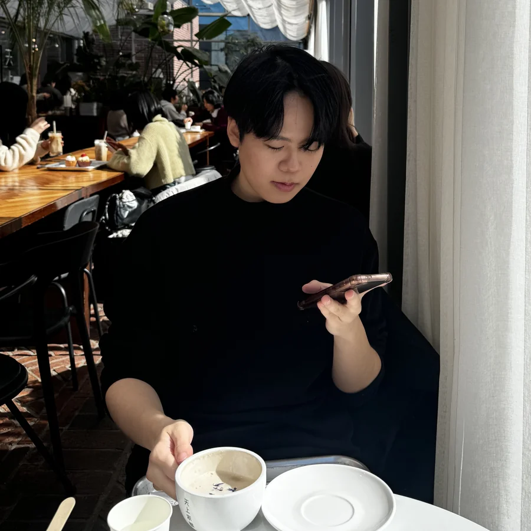

<section class="portfolio-intro" aria-labelledby="profile-name">
  

    <h1 id="profile-name">Chanhee Lee</h1>
    
I'm an undergraduate student interested in video understanding and multimodal learning, with a focus on spatiotemporal and multimodal representations for video summarization.

    

      <a class="portfolio-contact__cv" href="/files/cv.pdf"><i class="fa-solid fa-file-pdf" aria-hidden="true"></i> View CV</a>
      <a href="mailto:{{ site.author.email }}"><i class="fa-solid fa-envelope" aria-hidden="true"></i> Email</a>
      <a href="https://github.com/{{ site.author.github }}"><i class="fa-brands fa-github" aria-hidden="true"></i> GitHub</a>
    

  

  

    
  

</section>

<section class="portfolio-section portfolio-projects" aria-labelledby="projects">
  <h2 id="projects">Projects</h2>
  

    <article class="portfolio-project" id="p6">
      

        
May 2026 – Jun. 2026

        
Course Project

      

      

        <h3>Well Begun Is Half Solved: Future-Aware Route Optimization for Long Narrative Question Answering</h3>
        
Proposed FARO, an inference-time framework that commits to a future-aware evidence route before final answer generation for long narrative question answering.

        

          <a href="/files/FARO.pdf" aria-label="FARO report"><i class="fa-solid fa-file-pdf" aria-hidden="true"></i> Report</a>
          <a href="https://github.com/Bellissimo-AI/FARO" aria-label="FARO code"><i class="fa-brands fa-github" aria-hidden="true"></i> Code</a>
        

      

    </article>
    <article class="portfolio-project" id="p5">
      

        
Mar. 2026 – Jun. 2026

        
Course (Capstone) Project

      

      

        <h3>Beyond Highlight Detection: Most-Replayed Driven Multimodal Analysis of Korean YouTube Videos for Highlight Editing Guidance</h3>
        
Built a most-replayed driven multimodal analysis pipeline for Korean YouTube videos and generated category-aware highlight editing guidance.

        

          <a href="/kosum/" aria-label="KoSum project page"><i class="fa-solid fa-display" aria-hidden="true"></i> Project Page</a>
          <a href="/files/KoSum_report.pdf?v=20260614" aria-label="KoSum report"><i class="fa-solid fa-file-pdf" aria-hidden="true"></i> Report</a>
          <a href="https://github.com/iontail/dsc.git" aria-label="KoSum code"><i class="fa-brands fa-github" aria-hidden="true"></i> Code</a>
          <a href="https://huggingface.co/datasets/iontail/KoSum" aria-label="KoSum dataset"> Dataset</a>
        

      

    </article>
    <article class="portfolio-project" id="p4">
      

        
Oct. 2025 – Nov. 2025

        
Course Project

      

      

        <h3>Rethinking Diffusion-Based Augmentation: Why Single Prompt Fails</h3>
        
Conducted a controlled study on single-prompt diffusion-based augmentation and its impact on generalization.

        

          <a href="/files/Rethinking.pdf" aria-label="Rethinking Diffusion-Based Augmentation report"><i class="fa-solid fa-file-pdf" aria-hidden="true"></i> Report</a>
          <a href="https://github.com/iontail/gdl_term" aria-label="Rethinking Diffusion-Based Augmentation code"><i class="fa-brands fa-github" aria-hidden="true"></i> Code</a>
        

      

    </article>
    <article class="portfolio-project" id="p3">
      

        
May 2025 – Jun. 2025

        
Course Project

      

      

        <h3>N-TIDE: Debiasing Unimodal Vision Models via Neutral Text Inversion with CLIP</h3>
        
Developed a CLIP-guided two-stage framework to distill debiased semantic representations into a unimodal vision model.

        

          <a href="/files/N_TIDE.pdf" aria-label="N-TIDE report"><i class="fa-solid fa-file-pdf" aria-hidden="true"></i> Report</a>
          <a href="https://github.com/iontail/N-TIDE" aria-label="N-TIDE code"><i class="fa-brands fa-github" aria-hidden="true"></i> Code</a>
        

      

    </article>
    <article class="portfolio-project" id="p2">
      

        
Mar. 2025 – Jun. 2025

        
Undergraduate Research Program

      

      

        <h3>BRNet: Bio-Receptor Networks for Object Detection with Zero-Shot Domain Adaptation</h3>
        
Proposed and validated a biologically inspired luminance-adaptive detection framework for zero-shot day-to-night adaptation.

        

          <a href="/files/BRNet.pdf" aria-label="BRNet report"><i class="fa-solid fa-file-pdf" aria-hidden="true"></i> Report</a>
          <a href="https://github.com/iontail/BRNet" aria-label="BRNet code"><i class="fa-brands fa-github" aria-hidden="true"></i> Code</a>
        

      

    </article>
    <article class="portfolio-project" id="p1">
      

        
Jan. 2025 – Mar. 2025

        
AI Research Competition

      

      

        <h3>CoReaP: Collaborative Reconstruction with Assistive Priors</h3>
        
Proposed a frequency-guided two-path transformer architecture for structured and detail-preserving image inpainting.

        

          <a href="/files/CoReaP.pdf" aria-label="CoReaP report"><i class="fa-solid fa-file-pdf" aria-hidden="true"></i> Report</a>
          <a href="https://github.com/rkdrn79/CoReaP" aria-label="CoReaP code"><i class="fa-brands fa-github" aria-hidden="true"></i> Code</a>
        

      

    </article>
  

</section>

  <section class="portfolio-section" aria-labelledby="education">
    <h2 id="education">Education</h2>
    <article class="portfolio-entry">
      
Mar. 2021 – Present

      <h3>Sungkyunkwan University</h3>
      
B.S. in Applied Artificial Intelligence

      
Seoul, South Korea

    </article>
  </section>

  <section class="portfolio-section portfolio-experience" aria-labelledby="experience">
    <h2 id="experience">Experience</h2>
    <ol class="portfolio-timeline" role="list" reversed>
      <li class="portfolio-timeline__item">
        
        

          
<time datetime="2026-05">May 2026</time> – Present

          <h3><a href="https://viplab.snu.ac.kr/" target="_blank" rel="noopener">VIP (Visual Information Processing) Lab</a></h3>
          
Undergraduate Research Intern · Advisor: Prof. Joonseok Lee

          
Seoul National University, Seoul, South Korea

        

      </li>
      <li class="portfolio-timeline__item">
        
        

          
<time datetime="2025-09">Sep. 2025</time> – <time datetime="2025-12">Dec. 2025</time>

          <h3><a href="https://ell.skku.edu/" target="_blank" rel="noopener">Efficient Learning Laboratory (ELL)</a></h3>
          
Undergraduate Research Intern · Advisor: Prof. Hankook Lee

          
Sungkyunkwan University, Suwon, South Korea

        

      </li>
    </ol>
  </section>

  <section class="portfolio-section" aria-labelledby="awards">
    <h2 id="awards">Awards</h2>
    <article class="portfolio-entry">
      
Jun. 2025

      <h3>Dacon 2025 Bias-A-Thon Top 4</h3>
      
Developed prompt engineering and RAG methods for generating fair responses under biased scenarios.

    </article>
  </section>

